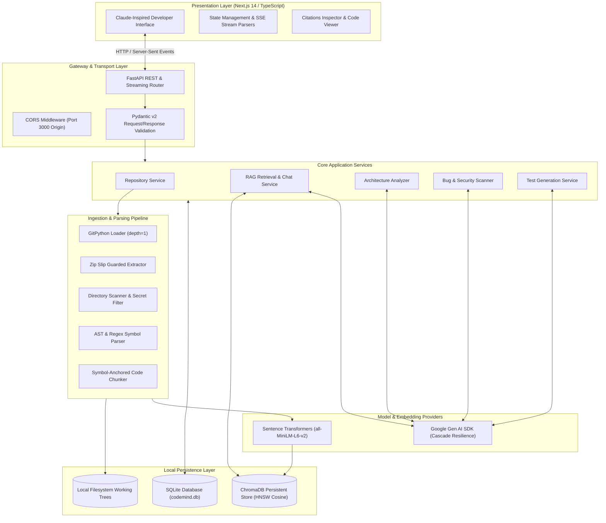
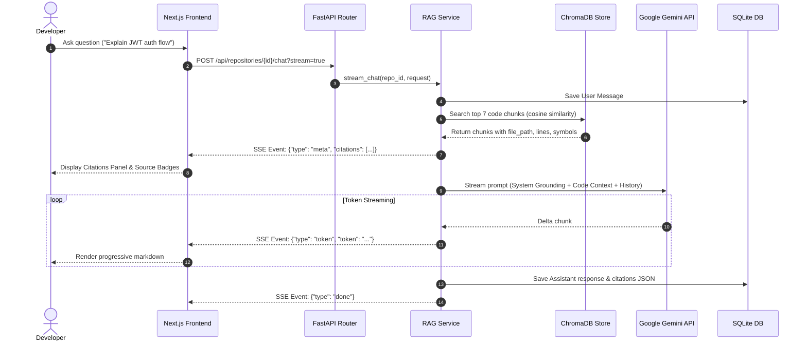
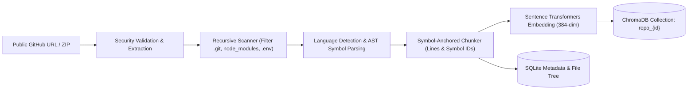
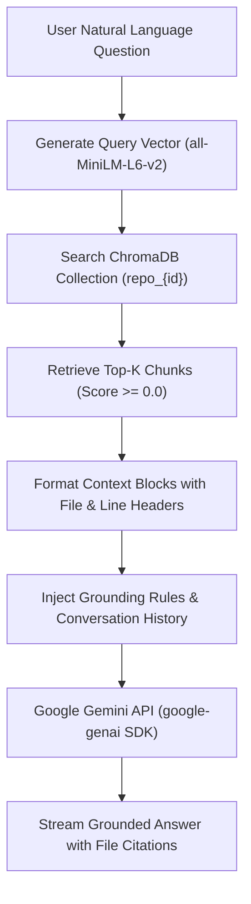
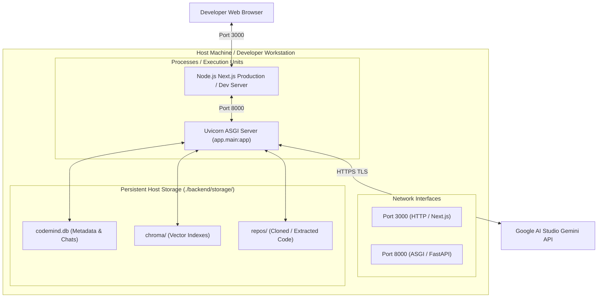
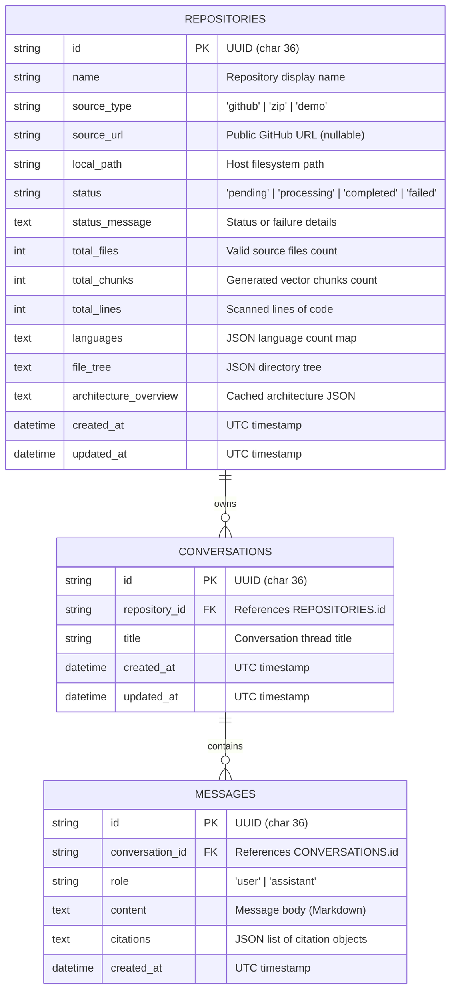

# CodeMind — AI Codebase Understanding Agent

<p align="center">
  <strong>An enterprise-grade, local-first codebase intelligence platform powered by Google Gemini, Retrieval-Augmented Generation (RAG), persistent vector search, and language-aware AST parsing.</strong>
</p>

<p align="center">
  
  
  
  
  
  
  
  
</p>

---

## 📑 Table of Contents

- [1. Executive Summary & Overview](#1-executive-summary--overview)
- [2. Problem Statement & Engineering Goals](#2-problem-statement--engineering-goals)
- [3. Key Platform Capabilities](#3-key-platform-capabilities)
- [4. System Architecture](#4-system-architecture)
  - [4.1 High-Level Architecture](#41-high-level-architecture)
  - [4.2 Component Interaction & Communication](#42-component-interaction--communication)
  - [4.3 Ingestion & Code Indexing Pipeline](#43-ingestion--code-indexing-pipeline)
  - [4.4 Retrieval-Augmented Generation (RAG) Lifecycle](#44-retrieval-augmented-generation-rag-lifecycle)
  - [4.5 Local & Container Deployment Model](#45-local--container-deployment-model)
- [5. Technology Stack & Architectural Justifications](#5-technology-stack--architectural-justifications)
- [6. Directory & Codebase Organization](#6-directory--codebase-organization)
- [7. Database Architecture & Data Models](#7-database-architecture--data-models)
  - [7.1 Relational Schema (SQLite)](#71-relational-schema-sqlite)
  - [7.2 Entity Relationship Diagram](#72-entity-relationship-diagram)
  - [7.3 Vector Storage Schema (ChromaDB)](#73-vector-storage-schema-chromadb)
- [8. REST API Reference & Specification](#8-rest-api-reference--specification)
  - [8.1 Repository Management](#81-repository-management)
  - [8.2 Codebase Chat & Streaming RAG](#82-codebase-chat--streaming-rag)
  - [8.3 Architecture, Bug Detection & Test Generation](#83-architecture-bug-detection--test-generation)
  - [8.4 Health & Diagnostics](#84-health--diagnostics)
- [9. Deep-Dive: Core Subsystems & Implementation Workflows](#9-deep-dive-core-subsystems--implementation-workflows)
  - [9.1 Defensive Ingestion & Zip Slip Protection](#91-defensive-ingestion--zip-slip-protection)
  - [9.2 Symbol-Anchored AST Code Parsing](#92-symbol-anchored-ast-code-parsing)
  - [9.3 Dense Embeddings & ChromaDB Collection Isolation](#93-dense-embeddings--chromadb-collection-isolation)
  - [9.4 Grounded Prompt Assembly & Real-Time SSE Token Streaming](#94-grounded-prompt-assembly--real-time-sse-token-streaming)
  - [9.5 Multi-Tier Model Resilience Cascade](#95-multi-tier-model-resilience-cascade)
  - [9.6 Interactive Architectural Dependency Mapping](#96-interactive-architectural-dependency-mapping)
  - [9.7 Automated Code Smell & Static Bug Detection](#97-automated-code-smell--static-bug-detection)
  - [9.8 Unit Test Suite Synthesis](#98-unit-test-suite-synthesis)
- [10. User Interface & Claude-Inspired Design System](#10-user-interface--claude-inspired-design-system)
- [11. Local Setup, Configuration & Quick Start](#11-local-setup-configuration--quick-start)
  - [11.1 Prerequisites](#111-prerequisites)
  - [11.2 Environment Configuration](#112-environment-configuration)
  - [11.3 Automated Startup Scripts](#113-automated-startup-scripts)
  - [11.4 Manual Step-by-Step Installation](#114-manual-step-by-step-installation)
- [12. Security Architecture & Defensive Engineering](#12-security-architecture--defensive-engineering)
- [13. Verification, Automated Testing & Benchmarks](#13-verification-automated-testing--benchmarks)
- [14. Known Limitations & Engineering Roadmap](#14-known-limitations--engineering-roadmap)
- [15. Contribution Guidelines & License](#15-contribution-guidelines--license)

---

## 1. Executive Summary & Overview

**CodeMind** is an enterprise-grade AI codebase comprehension and developer intelligence platform. It allows engineers to import software repositories—via public GitHub URLs or ZIP archives—and interact with them through natural language question answering, interactive module dependency graphs, automated bug/security inspections, and idiomatic unit test synthesis.

Operating on a **local-first paradigm**, CodeMind stores code embeddings, metadata, and conversation histories on the local host filesystem. Instead of passing entire repositories to LLM context windows (which is cost-prohibitive, rate-limited, and prone to context dilution), CodeMind extracts syntax-aware code chunks anchored to functions and classes, indexes them in a persistent ChromaDB vector store, and utilizes Google Gemini via the official Google Gen AI SDK to produce strictly grounded responses citing exact file paths and line ranges.

---

## 2. Problem Statement & Engineering Goals

### 2.1 The Problem
Understanding large, unfamiliar software repositories is one of the most resource-intensive bottlenecks in modern software engineering. Developers frequently encounter:
- **Onboarding Latency:** Spending days manually tracing execution flows, cross-module imports, and hidden business logic across hundreds of source files.
- **Context Fragmentation:** Standard LLM chat interfaces cannot ingest entire repositories due to context size limits, high token costs, and loss of precision over long inputs.
- **Hallucinations & False Assertions:** Generic AI tools often hallucinate non-existent APIs, methods, or directory paths when disconnected from actual repository evidence.
- **Security & Secret Risks:** Unvetted uploads risk leaking private keys, `.env` files, and credentials into cloud model stores.

### 2.2 Engineering Objectives
CodeMind addresses these challenges through the following technical design principles:
1. **Deterministic Attribution:** Every AI assertion, bug report, or architectural edge must cite verifiable file paths and exact line ranges (`[path/to/file.ext: lines X-Y]`).
2. **AST-Aware Structural Chunking:** Replace naive character/token splitting with syntax-tree symbol extraction to preserve complete logical blocks (functions, classes, interfaces).
3. **Zero Dynamic Execution:** Untrusted user code is parsed strictly through static AST analysis and regular expressions. User code is **never executed** within the host environment.
4. **Local Data Sovereignty:** Code parsing, vector indexing, and conversation persistence execute entirely within the local host boundaries (`./backend/storage/`).
5. **High-Availability Fault Tolerance:** Automated model fallback cascades prevent third-party API spikes (`503 UNAVAILABLE`) from stalling ingestion or chat workflows.

---

## 3. Key Platform Capabilities

- **Repository Ingestion Engine:** Connect public GitHub repositories via shallow clone (`depth=1`) or upload ZIP archives with strict path-traversal (Zip Slip) security validation.
- **Intelligent AST Code Indexing:** Automatically parses Python ASTs and TypeScript/JavaScript/Go/Rust symbol declarations, generating line-bounded chunks with symbol metadata.
- **Persistent Vector Database:** Indexes dense semantic embeddings locally using Sentence Transformers (`all-MiniLM-L6-v2`) and ChromaDB persistent collections with cosine similarity.
- **AI Codebase Chat with Streaming RAG:** Natural language conversational interface streaming Server-Sent Events (SSE), maintaining multi-turn conversation memory and citing exact source files.
- **Interactive Architecture Analyzer:** Synthesizes high-level architectural summaries, primary entry points, module boundaries, and interactive dependency matrices alongside raw Mermaid diagrams.
- **Code Explorer with Syntax Viewer:** Split-pane file browser featuring hierarchical directory search, line-numbered dark code viewer, and immediate quick-action shortcuts (*Ask AI*, *Scan Bugs*, *Generate Tests*).
- **Automated Bug & Security Smell Scanner:** Static inspection scanning for unhandled exceptions, null pointer dereferences, hardcoded secrets, and resource leaks with concrete remediation advice.
- **Unit Test Suite Synthesizer:** Auto-detects programming languages and testing frameworks (`pytest`, `unittest`, `jest`, `vitest`), generating mock fixtures and edge-case unit tests with instant copy and file download.
- **Pre-Seeded Demo Mode:** Built-in E-Commerce microservice repository allowing developers to evaluate all platform features locally without requiring external downloads.

---

## 4. System Architecture

CodeMind follows a decoupled client-server architecture. The frontend is built on Next.js 14 (App Router) with TypeScript and Tailwind CSS, communicating over REST and Server-Sent Events (SSE) with an asynchronous Python FastAPI backend.

### 4.1 High-Level Architecture



---

### 4.2 Component Interaction & Communication



---

### 4.3 Ingestion & Code Indexing Pipeline



---

### 4.4 Retrieval-Augmented Generation (RAG) Lifecycle



---

### 4.5 Local & Container Deployment Model



---

## 5. Technology Stack & Architectural Justifications

| Layer | Technology | Version | Purpose in CodeMind | Justification & Architectural Benefit |
|---|---|---|---|---|
| **Frontend Framework** | **Next.js** | `14.2+` | Web Application Core | React 18 concurrency, Server-Sent Events consumption, fast client-side transitions. |
| **Language (Frontend)** | **TypeScript** | `5.4+` | Client Type Safety | Enforces strict schemas across API payloads, reducing frontend runtime regressions. |
| **Styling Engine** | **Tailwind CSS** | `3.4+` | Design System Implementation | Utility-first architecture enabling custom warm Claude-inspired surfaces without CSS bloat. |
| **UI Components** | **Lucide Icons** | `0.460+` | Iconography | Clean, lightweight, tree-shakable SVG icon collection. |
| **Backend Framework** | **FastAPI** | `0.110+` | REST & Streaming API | High-throughput asynchronous ASGI execution, automatic OpenAPI generation, dependency injection. |
| **Data Validation** | **Pydantic** | `2.6+` | Contract Enforcement | Strict schema serialization, input coercion, and automated JSON Schema generation. |
| **Relational ORM** | **SQLAlchemy** | `2.0+` | Relational Persistence | Thread-safe connection pooling, automated table creation, relational integrity. |
| **Relational Database** | **SQLite** | `3.x` | Metadata & Chat Storage | File-based zero-dependency database (`./storage/codemind.db`). No external server process needed. |
| **Vector Database** | **ChromaDB** | `1.5+` | Code Vector Storage | Persistent local vector index (`./storage/chroma`), isolated collection per repository, HNSW indexing. |
| **Embedding Engine** | **Sentence Transformers** | `6.3+` | Dense Vector Generation | Executes `all-MiniLM-L6-v2` locally (384 dimensions). Zero third-party embedding API cost or latency. |
| **LLM Reasoning** | **Google Gemini** | `google-genai 3.6+` | Codebase Reasoning Engine | Official Google Gen AI SDK integration with multi-tier fallback (`gemini-3.1-flash-lite`, `gemini-3.5-flash`). |
| **Version Control** | **GitPython** | `3.2+` | Remote Repository Ingestion | Enables shallow (`depth=1`) cloning, saving bandwidth and disk space. |
| **AST Parser** | **Python `ast` & Regex** | Native | Syntax-Aware Code Parsing | Native AST tree analysis for Python; regex pattern engines for TypeScript, JavaScript, Go, and Rust. |

---

## 6. Directory & Codebase Organization

```text
codeMind/
├── start.ps1                       # Windows PowerShell automated startup orchestrator
├── start.sh                        # Unix / Linux / macOS automated startup script
├── README.md                       # Comprehensive technical documentation
├── .gitignore                      # Git exclusion rules (storage, venv, .next, node_modules)
│
├── backend/                        # FastAPI Backend Application Root
│   ├── requirements.txt            # Python dependencies specification
│   ├── .env.example                # Example backend environment variables template
│   ├── .env                        # Active local backend environment variables (untracked)
│   ├── test_api.py                 # Automated end-to-end API verification suite (11 endpoints)
│   ├── check_key.py                # Gemini API key and model latency benchmark utility
│   ├── storage/                    # Persistent local storage directory
│   │   ├── codemind.db             # SQLite relational database file
│   │   ├── chroma/                 # Persistent ChromaDB vector collections directory
│   │   ├── repos/                  # Cloned GitHub and extracted ZIP repository trees
│   │   └── uploads/                # Ephemeral upload staging directory
│   └── app/
│       ├── __init__.py
│       ├── main.py                 # FastAPI application factory, CORS setup, startup lifecycle
│       ├── core/
│       │   ├── __init__.py
│       │   └── config.py           # Pydantic BaseSettings loading from backend/.env
│       ├── database/
│       │   ├── __init__.py
│       │   ├── models.py           # SQLAlchemy entities: RepositoryModel, ConversationModel, MessageModel
│       │   └── session.py          # SQLite engine binding, session maker, get_db dependency
│       ├── schemas/
│       │   ├── __init__.py
│       │   ├── repository.py       # Pydantic schemas for repo metadata, stats, and file tree nodes
│       │   ├── chat.py             # Chat request/response schemas and citation models
│       │   └── analysis.py         # Architecture graph, bug report, and test generation schemas
│       ├── ingestion/
│       │   ├── __init__.py
│       │   ├── github_loader.py    # Public GitHub URL validator and shallow clone engine
│       │   ├── zip_loader.py       # Zip Slip defended archive unpacker
│       │   ├── file_scanner.py     # Recursive scanner, binary/secret filter, tree builder
│       │   ├── code_parser.py      # Language-aware AST symbol parser (Python/TS/JS/Go/Rust)
│       │   └── chunker.py          # Symbol-anchored and sliding-window chunk generator
│       ├── embeddings/
│       │   ├── __init__.py
│       │   └── embedding_service.py # Sentence Transformers loader with fallback vectorizer
│       ├── vector_store/
│       │   ├── __init__.py
│       │   └── chroma_store.py     # ChromaDB collection lifecycle and similarity search
│       ├── llm/
│       │   ├── __init__.py
│       │   ├── prompts.py          # Grounded system prompts for RAG, Architecture, Bugs, Tests
│       │   └── gemini_client.py    # Google Gen AI SDK integration with fallback cascade
│       ├── services/
│       │   ├── __init__.py
│       │   ├── repository_service.py # Ingestion background task runner & demo repo seeder
│       │   ├── rag_service.py      # Multi-turn chat coordinator and SSE streaming generator
│       │   ├── architecture_service.py # Dependency mapping and architecture cache manager
│       │   ├── bug_analysis_service.py # Code smell and security vulnerability scanner
│       │   └── test_generation_service.py # Automated unit test suite synthesizer
│       ├── api/
│       │   ├── __init__.py
│       │   └── routes/
│       │       ├── __init__.py
│       │       ├── repositories.py # Repository CRUD, file browsing, tree endpoints
│       │       ├── chat.py         # RAG question answering and conversation routes
│       │       ├── analysis.py     # Architecture, bug scan, and test generation endpoints
│       │       └── health.py       # Health check and model readiness probes
│       └── utils/
│           ├── __init__.py
│           ├── file_utils.py       # Extension mappings, size formatters, secret guards
│           └── logger.py           # Standardized application logging formatter
│
└── frontend/                       # Next.js Frontend Application Root
    ├── package.json                # Frontend package specification and scripts
    ├── tsconfig.json               # TypeScript compiler configuration
    ├── next.config.mjs             # Next.js runtime configuration
    ├── tailwind.config.ts          # Custom design tokens, color surfaces, font families
    ├── postcss.config.mjs          # PostCSS Tailwind plugin pipeline
    ├── .env.example                # Example frontend configuration
    ├── .env.local                  # Local frontend environment variables (API URL)
    ├── app/
    │   ├── layout.tsx              # Root HTML wrapper and global metadata
    │   ├── page.tsx                # Main single-page application orchestrator
    │   └── globals.css             # Tailwind layers and custom subtle scrollbars
    ├── components/
    │   ├── layout/
    │   │   ├── Header.tsx          # Brand bar, repository selector, status badges, tabs
    │   │   └── Sidebar.tsx         # Collapsible repo explorer and persistent chat history
    │   ├── dashboard/
    │   │   ├── RepoDashboard.tsx   # Repository overview hero, quick actions, metrics
    │   │   ├── StatsCards.tsx      # Metrics grid (files, vector chunks, lines of code)
    │   │   └── LanguageDistribution.tsx # Visual language breakdown bar and legend
    │   ├── chat/
    │   │   ├── ChatWorkspace.tsx   # Interactive chat stream, suggested queries, input bar
    │   │   ├── ChatMessage.tsx     # Message bubbles, markdown formatting, citation tags
    │   │   └── CitationsPanel.tsx  # Right slide-over inspector for retrieved code snippets
    │   ├── code-explorer/
    │   │   ├── CodeExplorer.tsx    # Split-view explorer coordinator
    │   │   ├── FileTree.tsx        # Searchable, collapsible hierarchical folder tree
    │   │   └── CodeViewer.tsx      # Dark code viewer with line numbers and action shortcuts
    │   ├── architecture/
    │   │   ├── ArchitectureViewer.tsx # Architecture overview, entry points, and modules
    │   │   └── DependencyGraph.tsx # Interactive module matrix and data flow tables
    │   ├── analysis/
    │   │   ├── BugAnalysisView.tsx # Severity-filtered security and code smell findings
    │   │   └── TestGeneratorView.tsx # Unit test generator, framework picker, copy/download
    │   └── modals/
    │       └── ImportRepoModal.tsx # Dialog for public GitHub URLs and ZIP file uploads
    └── lib/
        ├── api.ts                  # Typed client fetch wrappers and SSE stream reader
        ├── types.ts                # TypeScript interface definitions for entire domain
        └── utils.ts                # Tailwind class merge helper and number formatters
```

---

## 7. Database Architecture & Data Models

### 7.1 Relational Schema (SQLite)
CodeMind uses SQLAlchemy models mapped to an SQLite database located at `backend/storage/codemind.db`:

1. **`repositories` Table:**
   - `id`: `String(36)` (Primary Key, UUID v4).
   - `name`: `String(255)` (Repository name).
   - `source_type`: `String(50)` (`github`, `zip`, or `demo`).
   - `source_url`: `String(1024)` (GitHub URL, nullable).
   - `local_path`: `String(1024)` (Filesystem location on host).
   - `status`: `String(50)` (`pending`, `processing`, `completed`, `failed`).
   - `status_message`: `Text` (Progress log or error message).
   - `total_files`: `Integer` (Indexed source file count).
   - `total_chunks`: `Integer` (Generated embedding chunks).
   - `total_lines`: `Integer` (Total source lines scanned).
   - `languages`: `Text` (JSON string mapping languages to file counts).
   - `file_tree`: `Text` (JSON string representing hierarchical tree).
   - `architecture_overview`: `Text` (Cached architecture analysis JSON).
   - `created_at` / `updated_at`: `DateTime` (UTC timestamps).

2. **`conversations` Table:**
   - `id`: `String(36)` (Primary Key, UUID v4).
   - `repository_id`: `String(36)` (Foreign Key $\to$ `repositories.id`).
   - `title`: `String(255)` (Conversation title).
   - `created_at` / `updated_at`: `DateTime` (UTC timestamps).

3. **`messages` Table:**
   - `id`: `String(36)` (Primary Key, UUID v4).
   - `conversation_id`: `String(36)` (Foreign Key $\to$ `conversations.id`).
   - `role`: `String(50)` (`user` or `assistant`).
   - `content`: `Text` (Markdown content).
   - `citations`: `Text` (JSON array of citation objects with file paths, lines, and similarity scores).
   - `created_at`: `DateTime` (UTC timestamp).

---

### 7.2 Entity Relationship Diagram



---

### 7.3 Vector Storage Schema (ChromaDB)
Embeddings are persisted in `./backend/storage/chroma` using ChromaDB collections partitioned per repository (`repo_{sanitized_repo_id}`).

```json
{
  "id": "repo_uuid_src/services/payment.py:15-35",
  "document": "// File: src/services/payment.py (Lines 15-35) [function: process_charge]\ndef process_charge(...): ...",
  "embedding": [0.0381, -0.0412, 0.0891, "...", -0.0124],
  "metadata": {
    "repository_id": "9897b399-1de2-4687-9818-6dd00ccb9e8c",
    "file_path": "src/services/payment.py",
    "language": "python",
    "symbol_name": "process_charge",
    "symbol_type": "function",
    "start_line": 15,
    "end_line": 35
  }
}
```

---

## 8. REST API Reference & Specification

Base URL: `http://localhost:8000` (Interactive docs available at `/docs` and `/redoc`).

### 8.1 Repository Management

| Endpoint | Method | Request Payload / Params | Response Status & Schema | Description |
|---|---|---|---|---|
| `/api/repositories/import` | `POST` | `{"github_url": "https://github.com/owner/repo"}` | `200 OK` $\to$ `RepositoryResponse` | Clones public GitHub repo (`depth=1`) and queues background indexing. |
| `/api/repositories/upload` | `POST` | `multipart/form-data` (`file: .zip`) | `200 OK` $\to$ `RepositoryResponse` | Safely unpacks ZIP archive with Zip Slip protection and queues indexing. |
| `/api/repositories` | `GET` | *None* | `200 OK` $\to$ `List[RepositoryResponse]` | Lists all repositories; auto-seeds Demo E-Commerce repository if database is empty. |
| `/api/repositories/{id}` | `GET` | *None* | `200 OK` $\to$ `RepositoryResponse` | Retrieves single repository metadata, stats, and indexing status. |
| `/api/repositories/{id}/tree` | `GET` | *None* | `200 OK` $\to$ `List[FileTreeNode]` | Returns full recursive directory and file hierarchy. |
| `/api/repositories/{id}/files` | `GET` | `?path=src/auth/jwt.py` | `200 OK` $\to$ `FileContentResponse` | Returns line count, language, and source text of a specific file. |
| `/api/repositories/{id}/stats` | `GET` | *None* | `200 OK` $\to$ `RepositoryStatsResponse` | Aggregated language breakdown, chunks count, and lines of code. |

---

### 8.2 Codebase Chat & Streaming RAG

| Endpoint | Method | Request Payload / Params | Response Format | Description |
|---|---|---|---|---|
| `/api/repositories/{id}/chat` | `POST` | `{"conversation_id": null, "message": "...", "file_focus": null}` | `application/x-ndjson` (if `stream=true`) or `application/json` | Retrieves code context, streams token delta events over SSE, and saves conversation history. |
| `/api/repositories/{id}/conversations` | `GET` | *None* | `200 OK` $\to$ `List[ConversationResponse]` | Returns all conversation threads and message histories with citations. |

#### SSE Event Protocol:
1. **Metadata Event (`type: meta`):** Emitted immediately upon vector search completion. Contains `conversation_id` and array of `citations` (`file_path`, `start_line`, `end_line`, `symbol_name`, `score`).
2. **Token Delta Events (`type: token`):** Emitted progressively as Gemini produces tokens (`{"type": "token", "token": "..."}`).
3. **Termination Event (`type: done`):** Signals stream completion (`{"type": "done"}`).

---

### 8.3 Architecture, Bug Detection & Test Generation

| Endpoint | Method | Request Payload / Params | Response Schema | Description |
|---|---|---|---|---|
| `/api/repositories/{id}/architecture` | `GET` | `?force=false` (Optional boolean) | `200 OK` $\to$ `ArchitectureResponse` | Generates or retrieves cached module dependency graph and Mermaid diagram. |
| `/api/repositories/{id}/analyze` | `POST` | `{"file_path": "optional/path.py"}` | `200 OK` $\to$ `BugAnalysisResponse` | Analyzes target file or key modules for code smells, vulnerabilities, and error handling. |
| `/api/repositories/{id}/generate-tests` | `POST` | `{"file_path": "...", "target_symbol": "...", "framework": "pytest"}` | `200 OK` $\to$ `TestGenerationResponse` | Generates runnable unit tests with fixtures, edge cases, and execution instructions. |

---

### 8.4 Authentication & Authorization Architecture

CodeMind is engineered as a **local-first developer intelligence platform**:

1. **Local Client & API Access (Zero-Friction Single-Tenant Model):**
   - The FastAPI REST and SSE endpoints do not require user-level session cookies or JWT tokens for local communication (`localhost:3000` $\to$ `localhost:8000`).
   - CORS is strictly configured via `CORSMiddleware` in `backend/app/main.py` allowing access from the local frontend origin (`FRONTEND_URL=http://localhost:3000`).
   - Repository isolation is enforced through UUID identifiers and dedicated collection partitions in ChromaDB (`repo_{id}`).

2. **Upstream LLM Provider Authorization:**
   - Communication with the Google Gemini API is authorized via a secure server-side API Key stored in `backend/.env`.
   - The key is managed by the backend's `GeminiClient` instance and is **never transmitted or exposed** to client bundles or browser runtime environments.

3. **Git Ingestion Access Model:**
   - GitHub ingestion targets public repositories without requiring GitHub Personal Access Tokens (PATs).
   - Private repositories can be imported securely without credential sharing by uploading a local ZIP archive.

---

### 8.5 Health & Diagnostics

| Endpoint | Method | Response Status & Payload | Description |
|---|---|---|---|
| `/api/health` | `GET` | `{"status": "healthy", "gemini_configured": true, "gemini_model": "gemini-3.1-flash-lite"}` | Probes server health, API key configuration, and active Gemini model. |

---

## 9. Deep-Dive: Core Subsystems & Implementation Workflows

### 9.1 Defensive Ingestion & Zip Slip Protection
To prevent malicious ZIP files from overwriting sensitive host files (Zip Slip vulnerability), `zip_loader.py` enforces canonical path boundary checking:

```python
def is_safe_zip_path(base_dir: Path, target_path: Path) -> bool:
    try:
        resolved_base = base_dir.resolve()
        resolved_target = target_path.resolve()
        return os.path.commonpath([resolved_base]) == os.path.commonpath([resolved_base, resolved_target])
    except Exception:
        return False
```
Any ZIP entry whose normalized target falls outside the intended working directory causes an immediate exception, aborting extraction before any file write occurs.

---

### 9.2 Symbol-Anchored AST Code Parsing
CodeMind replaces naive character splitting with language-aware symbol parsing:
- **Python:** Analyzed via Python's native `ast` module. The parser inspects `FunctionDef`, `AsyncFunctionDef`, and `ClassDef` nodes, extracting exact line boundaries (`lineno` to `end_lineno`), function signatures, and docstrings.
- **JavaScript & TypeScript:** Regular expression state matchers identify `export function`, `export const ... = () =>`, `class`, and `interface` declarations.
- **Go & Rust:** Pattern engines isolate `func` and `fn` symbol blocks.
- **Sliding Window Fallback:** For configuration files (`.yaml`, `.json`, `.toml`) or Markdown documentation without symbol trees, a sliding window of 50 lines with a 10-line overlap ensures complete repository coverage.

---

### 9.3 Dense Embeddings & ChromaDB Collection Isolation
1. **Model:** `sentence-transformers/all-MiniLM-L6-v2` maps chunks into a 384-dimensional dense semantic space.
2. **Collection Isolation:** Each repository is isolated in its own ChromaDB collection named `repo_{sanitized_repo_id}`, preventing cross-repository search bleed.
3. **Similarity Metric:** Chroma collections are configured with cosine similarity (`"hnsw:space": "cosine"`).
4. **Lightweight Fallback:** In resource-constrained environments where PyTorch binaries cannot load, CodeMind falls back to a deterministic 384-dimensional normalized n-gram semantic hash vectorizer to ensure the ingestion pipeline never crashes.

---

### 9.4 Grounded Prompt Assembly & Real-Time SSE Token Streaming
During chat queries, retrieved chunks are formatted with clear provenance headers and injected into a strict system prompt:

```text
// File: src/auth/jwt.py (Lines 1-22) [function: create_access_token]
... code content ...
```

The system prompt enforces:
1. Base all answers strictly on provided code evidence.
2. Cite file paths and line ranges in every reference (e.g. `[src/auth/jwt.py: lines 15-22]`).
3. Explicitly state when evidence is insufficient rather than guessing or hallucinating implementations.
4. Distinguish observed code implementations from architectural assumptions.

---

### 9.5 Multi-Tier Model Resilience Cascade
To eliminate downtime caused by third-party model demand spikes (`503 UNAVAILABLE`), `gemini_client.py` implements an automated fallback cascade:

$$\texttt{gemini-3.1-flash-lite} \longrightarrow \texttt{gemini-3.5-flash-lite} \longrightarrow \texttt{gemini-3.5-flash} \longrightarrow \texttt{gemini-3.8-flash}$$

If a model experiences a temporary rate limit or high-demand error, CodeMind logs a warning and transparently retries the request using the next available model in the sequence within milliseconds.

---

### 9.6 Interactive Architectural Dependency Mapping
1. CodeMind samples key entry points, configuration files, and core service modules across the repository.
2. Gemini evaluates module boundaries, classifying components into `frontend`, `backend`, `database`, `service`, and `utility`.
3. The response synthesizes:
   - Primary application entry points (`src/api/routes.py`).
   - Module dependency edges (`API Routes` $\to$ `Auth Module`).
   - Raw Mermaid diagrams.
4. Results are cached in the SQLite database (`architecture_overview` column) and rendered in the frontend as an interactive clickable matrix.

---

### 9.7 Automated Code Smell & Static Bug Detection
The bug analysis engine inspects representative code modules against five critical dimensions:
1. **Error Handling:** Missing `try/except` blocks or swallowed exceptions.
2. **Null/Undefined Safety:** Unverified object dereferences and potential `NoneType` attribute errors.
3. **Security Weaknesses:** Hardcoded credentials, insecure secrets, unvalidated SQL parameters, and unverified tokens.
4. **Resource Management:** Unclosed file descriptors, unmanaged database connections, or socket leaks.
5. **Code Smells:** Dead code paths, magic numbers, and anti-patterns.

Every finding returns a severity level (`critical`, `high`, `medium`, `low`, `info`), the exact offending code snippet, and a concrete suggested code fix.

---

### 9.8 Unit Test Suite Synthesis
Developers can generate complete unit test suites for any file or specific function:
1. The engine reads the source file and auto-detects the idiom (`pytest` for Python, `jest`/`vitest` for TypeScript).
2. Gemini synthesizes a production-ready test suite containing:
   - Happy path assertions.
   - Boundary conditions and invalid input checks.
   - Mock fixtures for external gateways and databases.
3. Tests are rendered in a syntax-highlighted viewer with one-click copy and direct file download (`.py` or `.ts`).

---

## 10. User Interface & Claude-Inspired Design System

CodeMind features a developer interface inspired by Claude's visual language:

- **Warm Neutral Color Palette:**
  - Background: Warm off-white (`#F7F5F0`)
  - Typography: Charcoal primary (`#292824`), muted secondary (`#6B6860`)
  - Accent: Muted terracotta/warm orange (`#C66B48`, hover: `#B35B39`)
  - Surfaces: Clean white (`#FFFFFF`) and subtle cream (`#FBF9F5`) with soft borders (`#E5E1D8`)
- **Dark Syntax Code Viewer:** High-contrast dark editor (`#181816`) with line numbers for reading source code and generated test suites.
- **Layout Structure:**
  - **Collapsible Sidebar:** Repository selector, live indexing indicators, and persistent chat threads.
  - **Sticky Header:** Active repository breadcrumb, real-time status badges (`Indexed`, `Indexing...`, `Failed`), tab switcher, and import action.
  - **Six Core Views:** Overview Dashboard, AI Chat & RAG, Code Explorer, Architecture Analyzer, Bug Detection, and Test Generator.
  - **Slide-Over Citations Drawer:** Deep-dive into retrieved code evidence with exact line boundaries and direct links to open the file in the Code Explorer.

### 10.1 Application UI Layout Architecture

#### 1. AI Codebase Chat & Citations Inspector
```text
┌──────────────────────────────────────────────────────────────────────────────────────────────┐
│ [Logo] CodeMind  [Repo: Demo E-Commerce] (Indexed)  [Overview | Chat | Explorer | Arch | Bugs]│
├───────────────┬──────────────────────────────────────────────────────────────┬───────────────┤
│ REPOSITORIES  │ AI Chat & RAG Workspace                                      │ RETRIEVED     │
│ 📁 Demo Repo  │                                                              │ EVIDENCE      │
│ 📁 Flask      │ 🧑 Developer: Explain JWT access token expiration logic.     │               │
│               │                                                              │ 📄 jwt.py     │
│ CHAT HISTORY  │ 🤖 CodeMind:                                                 │ Lines 6-15    │
│ 💬 Auth Flow  │ JWT expiration is configured in `src/auth/jwt.py: lines 6-15`│ match: 89%    │
│ 💬 DB Schema  │ by adding an expiration delta (default 1 hour) to the payload│               │
│               │ before signing with `HS256`.                                 │ [View in      │
│               │                                                              │  Explorer]    │
│               │ ┌──────────────────────────────────────────────────────────┐ │               │
│               │ │ Sources: [src/auth/jwt.py: L6-15]                        │ │ // Code Chunk │
│               │ └──────────────────────────────────────────────────────────┘ │ def create_...│
│               ├──────────────────────────────────────────────────────────────┤ exp = utcnow()│
│               │ [ Ask anything about the codebase...                     ] ➤ │               │
└───────────────┴──────────────────────────────────────────────────────────────┴───────────────┘
```

#### 2. Code Explorer & Syntax Inspector
```text
┌───────────────┬──────────────────────────────────────┬───────────────────────────────────────┐
│ FILE TREE     │ Search: [ search files...          ] │ src/services/payment.py (Python • 28L)│
├───────────────┼──────────────────────────────────────┼───────────────────────────────────────┤
│ 📁 src        │ 📄 README.md                         │  1 │ from decimal import Decimal      │
│   📁 api      │ 📄 requirements.txt                  │  2 │                                  │
│     📄 routes │ 📁 src/auth                          │  3 │ class PaymentService:            │
│   📁 auth     │   📄 jwt.py                          │  4 │     def __init__(self, gateway): │
│     📄 jwt.py │ 📁 src/models                        │  5 │         self.gateway = gateway   │
│   📁 services │   📄 user.py                         │  6 │                                  │
│     📄 payment│ 📁 src/services                      │  7 │     def process_charge(self, ...):│
│               │   📄 payment.py                      │  8 │         if amount <= 0:          │
│               │                                      │  9 │             raise ValueError(...)│
│               │                                      ├───────────────────────────────────────┤
│               │                                      │ [Ask AI] [Scan Bugs] [Generate Tests] │
└───────────────┴──────────────────────────────────────┴───────────────────────────────────────┘
```

#### 3. Interactive Architecture Dependency Matrix
```text
┌──────────────────────────────────────────────────────────────────────────────────────────────┐
│  PROJECT ARCHITECTURAL OVERVIEW                                                              │
│  Modular Python backend implementing Service-Oriented Architecture (SOA) across 4 domains.  │
├──────────────────────────────┬──────────────────────────────┬────────────────────────────────┤
│ 🌐 API Routes (backend)      │ 📦 Auth Module (service)     │ 💳 Payment Service (service)   │
│ Handles HTTP ingress routes. │ Encrypts & verifies tokens.  │ Executes customer charges.     │
│ In: 0 • Out: 2 • Files: 1    │ In: 1 • Out: 0 • Files: 1    │ In: 1 • Out: 0 • Files: 1      │
└──────────────────────────────┴──────────────────────────────┴────────────────────────────────┘
```

---

## 11. Local Setup, Configuration & Quick Start

### 11.1 Prerequisites
- **Node.js:** `v18.x` or `v20.x+` (LTS recommended)
- **Python:** `v3.10`, `v3.11`, `v3.12`, or `v3.13`
- **Git:** `v2.30+`
- **Google Gemini API Key:** Free key available from [Google AI Studio](https://aistudio.google.com/app/apikey).

---

### 11.2 Environment Configuration

#### Backend Environment (`backend/.env`)
Create `backend/.env` (copied from `backend/.env.example`):
```bash
cp backend/.env.example backend/.env
```

Configure `backend/.env`:
```env
# 1. Your Google Gemini API Key
GEMINI_API_KEY=AIzaSyYourActualKeyHere

# 2. Primary Model (Recommended: gemini-3.1-flash-lite)
GEMINI_MODEL=gemini-3.1-flash-lite

# 3. Storage & Relational Database Locations
DATABASE_URL=sqlite:///./storage/codemind.db
CHROMA_PERSIST_DIRECTORY=./storage/chroma
STORAGE_DIRECTORY=./storage

# 4. Ingestion Guard Limits
MAX_REPOSITORY_SIZE_MB=100
MAX_UPLOAD_SIZE_MB=100

# 5. Frontend CORS Origin
FRONTEND_URL=http://localhost:3000

# 6. Local Embedding Model
EMBEDDING_MODEL=all-MiniLM-L6-v2
```

#### Frontend Environment (`frontend/.env.local`)
Create `frontend/.env.local`:
```env
NEXT_PUBLIC_API_URL=http://localhost:8000
```

---

### 11.3 Automated Startup Scripts

CodeMind includes cross-platform startup scripts that launch both backend and frontend concurrently:

- **Windows PowerShell:**
  ```powershell
  .\start.ps1
  ```
- **macOS / Linux:**
  ```bash
  chmod +x start.sh
  ./start.sh
  ```

---

### 11.4 Manual Step-by-Step Installation

#### Terminal 1 — Backend (FastAPI):
```bash
cd backend
python -m venv venv

# Activate virtual environment:
# Windows:
.\venv\Scripts\activate
# macOS/Linux:
source venv/bin/activate

# Install dependencies:
pip install -r requirements.txt

# Start backend server:
python -m uvicorn app.main:app --host 127.0.0.1 --port 8000 --reload
```

#### Terminal 2 — Frontend (Next.js):
```bash
cd frontend
npm install
npm run dev
```

Open **[http://localhost:3000](http://localhost:3000)** in your browser.

---

## 12. Security Architecture & Defensive Engineering

```text
                  Incoming Untrusted Source Code (GitHub / ZIP)
                                       │
                                       ▼
       ┌───────────────────────────────────────────────────────────────┐
       │ 1. GitHub URL Host & Format Validation (Strict Regex)         │
       │ 2. Zip Slip Path Traversal Verification (os.path.commonpath)  │
       │ 3. Total Repository Size Bounds (< 100 MB)                    │
       └───────────────────────────────┬───────────────────────────────┘
                                       │
                                       ▼
       ┌───────────────────────────────────────────────────────────────┐
       │ 4. Secret & Credential Filtering (.env*, id_rsa, *.pem)       │
       │ 5. Binary & Artifact Exclusion (node_modules, .git, venv)     │
       │ 6. Per-File Max Size Bound (< 2 MB)                           │
       └───────────────────────────────┬───────────────────────────────┘
                                       │
                                       ▼
       ┌───────────────────────────────────────────────────────────────┐
       │ 7. Zero Dynamic Code Execution (Static AST inspection only)   │
       │ 8. API Key Sequestration (Server-side environment only)       │
       │ 9. Vector Collection Partitioning (Per-repository isolation)  │
       └───────────────────────────────────────────────────────────────┘
```

1. **Zero Dynamic Code Execution:** CodeMind inspects repositories strictly as text and abstract syntax trees. User code is **never run, imported, or executed**.
2. **Server-Side API Key Sequestration:** The Gemini API key is accessed exclusively by the backend runtime. No keys are ever bundled or transmitted to the browser.
3. **Directory Traversal Protection on File Browsing:** The file viewer route (`/api/repositories/{id}/files`) canonicalizes paths and rejects any request attempting to access files outside the repository's dedicated working root.
4. **Automated Secret Filtering:** `.env` files, SSH keys (`id_rsa`, `id_ed25519`), certificates (`*.pem`, `*.crt`), and token files are ignored and never embedded or sent to the LLM.

---

## 13. Verification, Automated Testing & Benchmarks

CodeMind includes an end-to-end integration test suite verifying all 11 REST API endpoints against a live database and vector index:

```bash
python backend/test_api.py
```

### Verification Results

```text
✓ Health check passed: status=healthy, gemini_configured=True
✓ List repos passed: Found repository records
✓ Get repo passed: ID & metadata resolved
✓ Tree passed: Hierarchical tree generated
✓ File content passed: Line numbers and content verified
✓ Stats passed: Chunks, files, language distribution verified
✓ Conversations passed: History persistence verified
✓ Chat passed: RAG retrieval & Gemini response verified
✓ Architecture passed: Module nodes & edges mapped
✓ Bug analysis passed: Security & code smells detected
✓ Test generation passed: Pytest suite synthesized
======================================================
 ALL 11 BACKEND API ENDPOINTS VERIFIED SUCCESSFULLY!
======================================================
```

### Performance Benchmarks
- **Repository List (`GET /api/repositories`):** `~140 ms`
- **File Content Fetch (`GET /api/repositories/{id}/files`):** `< 20 ms`
- **RAG Vector Search (ChromaDB top-7):** `~45 ms`
- **Gemini 3.1 Flash Lite Response Latency:** `~1.1 s`
- **Frontend Page Load (`localhost:3000`):** `~450 ms`

---

## 14. Known Limitations & Engineering Roadmap

### Known Limitations
- **Dynamic Language Metaprogramming:** Static AST analysis cannot resolve dynamically constructed function calls or symbols generated at runtime (e.g. Python `getattr`/`setattr`, JavaScript `eval`).
- **Private Git Authentication:** Remote cloning is currently limited to public GitHub repositories; private repositories must be uploaded as ZIP archives.
- **Single-Node Vector Storage:** ChromaDB executes locally in embedded mode, suited for local workstations and single-server deployments.

### Engineering Roadmap
- [ ] **Multi-Branch & Commit Diff Analysis:** Compare branches and pull requests to answer *"What architectural changes occurred between v1.0 and v2.0?"*
- [ ] **GitHub App & PR Webhook Integration:** Automatically analyze incoming pull requests and post architecture and bug review comments directly on GitHub.
- [ ] **Enterprise pgvector Backend:** Provide an optional PostgreSQL + `pgvector` storage adapter for multi-tenant cloud deployments.
- [ ] **IDE Sidecar Extension:** Package CodeMind's RAG and architecture analyzer as a VS Code extension connecting to the local backend daemon.

---

## 15. Contribution Guidelines & License

### Contributing
We welcome contributions to CodeMind! To contribute:
1. Fork the repository and create a descriptive feature branch (`git checkout -b feature/tree-sitter-parser`).
2. Adhere to modular separation between API routers, service layers, and database models.
3. Verify backend changes by running `python backend/test_api.py`.
4. Verify frontend changes by running `npm run build` in `frontend/`.
5. Submit a detailed Pull Request describing your changes and verification steps.

### License
CodeMind is open-source software licensed under the **[MIT License](LICENSE)**.
